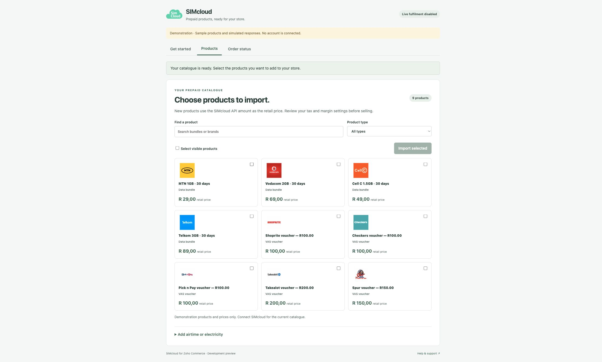
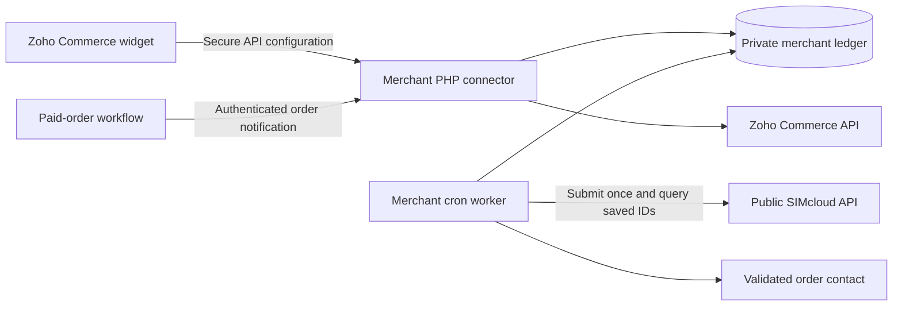

# SIMcloud for Zoho Commerce

**Sell South African airtime, data bundles, VAS vouchers and prepaid electricity using the SIMcloud API.**

[](https://github.com/ErikThiart/simcloud-zoho-commerce/actions/workflows/checks.yml)
[](LICENSE)

An open-source Zoho Commerce integration with a native product-import widget, bundled network and voucher logos, and a standalone procedural PHP connector. Merchants use their own SIMcloud accounts and Zoho stores.

> **Development alpha — not listed in Zoho Marketplace or certified for production.** This is a developer installation. Native checkout, payment-gateway verification and funded delivery still require acceptance testing. Public packages are deliberately unconfigured: they contain no merchant credentials, store identifiers or account bindings. Live fulfilment defaults to disabled.

[Install the developer alpha](docs/installation.md) · [Screenshots](docs/screenshots.md) · [Architecture](docs/architecture.md) · [Verification](docs/verification.md) · [Marketplace checklist](docs/marketplace.md)



*The screenshot shows the real widget with synthetic demonstration data. It does not show a connected account, completed checkout or live delivery.*

## Features

| Feature | Behaviour |
| --- | --- |
| Data bundles | Load the SIMcloud product-list API and import valid network/amount bundles. |
| VAS vouchers | Create a product for each available voucher denomination. |
| Airtime | Add fixed-value airtime products for supported South African networks. |
| Prepaid electricity | Add fixed-value electricity products with meter validation before fulfilment. |
| Default logos | Bundle 23 original network and VAS product images; upload local files to Zoho. |
| Initial retail price | Publish new products using the API amount; preserve existing merchant names, prices and images. |
| Verified payment | Fetch the actual Zoho order before queueing and before purchase. Fail closed when payment evidence is incomplete. |
| Duplicate protection | Claim each order line atomically and save the provider identity before polling. |
| Unknown outcome | Hold for reconciliation; never automatically repeat an uncertain purchase POST. |
| Voucher and electricity codes | Encrypt private delivery data and expose it only through the authenticated merchant connector. |

See [how the public SIMcloud API is used](docs/api-contract.md) and [what has been tested](docs/verification.md).

## Quick start

For a local demonstration, install Node.js 22+, Python 3 and PHP 8.2+ with PDO SQLite, OpenSSL and cURL:

```sh
git clone https://github.com/ErikThiart/simcloud-zoho-commerce.git
cd simcloud-zoho-commerce
npm test
npm run check
npm run build
npm run preview
```

Open `http://127.0.0.1:8128/app/widget.html?demo=1`. Demo mode uses synthetic fixtures, makes no provider requests and creates no real products.

The build creates three ZIPs under `dist/`:

| Package | Install location |
| --- | --- |
| `simcloud-zoho-widget-*.zip` | Zoho global sidebar and sales-order sidebar widget |
| `simcloud-zoho-settings-*.zip` | Zoho installation-settings widget |
| `simcloud-zoho-connector-*.zip` | Merchant-controlled, isolated PHP hosting |

For an account-connected installation, follow the [step-by-step guide](docs/installation.md). Configure credentials privately on the connector host and save only the limited connector key in Zoho's secure connection system. Account-specific widget metadata is supplied through local build options; the repository's default build contains none.

## How it works



This repository contains the reusable plugin and standalone connector. Each merchant supplies an independent deployment, private configuration and authorization. It contains no SIMcloud website backend, account-session adapter or production deployment tooling.

## Requirements and limits

- A compatible Zoho Commerce plan with widgets and API Configurations enabled; check [Zoho's current requirements](https://www.zoho.com/commerce/developer/widgets/api-configurations/).
- An isolated HTTPS connector host with local SQLite storage outside its public document root.
- A SIMcloud account and API token, plus the merchant's Zoho OAuth authorization, for connected operation.
- Recipient and meter layouts verified on the actual storefront and fresh order API before selling.
- An explicitly tested and allowed online payment gateway. Offline, unpaid and test orders cannot trigger live purchases.
- One prepaid unit per order line. Separate recipients require separate lines.
- No assumed provider refund API or guaranteed exactly-once acceptance after a network timeout.

For a one-click merchant installation, wait for a reviewed marketplace release. The current alpha requires developer setup and testing.

## Documentation and support

- [Installation and uninstall](docs/installation.md)
- [Developer testing and release gates](docs/verification.md)
- [Private configuration and public-source boundaries](docs/public-source-policy.md)
- [Contributing](CONTRIBUTING.md), [support](SUPPORT.md) and [private security reporting](SECURITY.md)
- [SIMcloud API documentation](https://simcloud.co.za/api/index.html)
- [SIMcloud for WordPress and WooCommerce](https://github.com/ErikThiart/simcloud-woocommerce)
- [Official references](docs/sources.md)

## Licence and trademarks

Code is licensed under [GPL-2.0-or-later](LICENSE). Third-party brand assets are documented in the [image notice](app/images/NOTICE.md) and [source manifest](app/images/sources.json); the code licence does not grant trademark rights. Zoho and the mobile/voucher brands remain the property of their respective holders. Inclusion does not imply endorsement.
