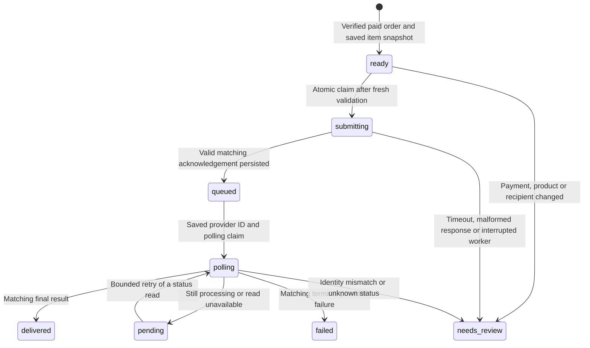

# Architecture and order recovery

The extension has three runtime packages: a native HTML/CSS/JavaScript sidebar widget, a separate installation-settings widget hosted by Zoho, and a procedural PHP connector deployed once per merchant. Zoho API Configurations and a secure connection proxy widget requests. The browser receives API configuration names, never SIMcloud tokens, OAuth refresh tokens or bridge credentials.

The connector's private SQLite ledger is bound to exactly one Zoho organization. Recipient/meter snapshots and delivery codes use OpenSSL AES-256-GCM authenticated encryption with a separately stored 32-byte key. Product metadata contains no shopper details. Logs contain controlled event names and identifiers, not provider bodies, contact details or redeemable codes.

## Submission lifecycle

There is no automatic transition from `needs_review`, `failed` or `submitting` back to `ready`. A merchant reference is not assumed to be a provider idempotency key. If a provider accepts a purchase and the response is lost, the connector cannot guarantee exactly-once provider acceptance; it prevents automatic repetition and requires reconciliation.

## Trust boundaries

- Browser input, webhook data and storefront retail prices cannot choose the provider face value. The amount comes from the saved imported product mapping.
- The connector fetches the current Zoho order before queueing and again before purchase. It requires ZAR, a paid invoice status, eligible order status, explicit non-test/non-offline flags, a configured gateway and sufficient payment records with online transaction references.
- Missing payment evidence fails closed. Actual gateway field shapes must be tested before adding a gateway to the allowlist.
- The recipient and meter come from the current order line's configured API field names; quantity must be one.
- Data purchases use network plus amount, not catalogue ID as a substitute. Ambiguous catalogue selections are skipped.
- Electricity meter support is checked before purchase; all returned token entries are retained in order.

## Storage, polling and mail

SQLite must run on local disk, outside the public root, with private permissions and backups. Do not place it on a shared/network filesystem or reuse it across stores. `UNIQUE(order_id,line_id)` prevents duplicate records. A conditional state update claims each submission before the POST. Eight-process testing exercises this boundary with real SQLite.

Polling uses saved IDs, at most 16 reads and a one-hour window. A worker interrupted during a status GET can safely retry the read. An interrupted purchase is held for review after 120 seconds. Pausing live fulfilment stops new creates but does not stop reconciliation reads for accepted orders.

Voucher/token email uses the single validated order contact. Multiple distinct contacts block automatic voucher/token submission. Codes remain available through the authenticated merchant widget. Mail is claimed once; an uncertain result requires manual review instead of unbounded resends. PHP mail acceptance alone does not prove customer receipt.

## Import recovery

Stable SKUs identify catalogue entries. Imports scan all product pages and stop if pagination is incomplete or SKUs collide. A durable `creating` claim is written before product creation. Uncertain product creation stays in `needs_review`; a later import never blindly repeats it. Existing merchant names, prices, visibility and images are not overwritten. Deleted/moved mappings are preserved for review.

Reconciliation in this alpha is operational: inspect the Zoho product or SIMcloud order using the saved identity, back up the private database, and record the outcome. There is intentionally no public endpoint that resets purchase claims or issues another purchase.
