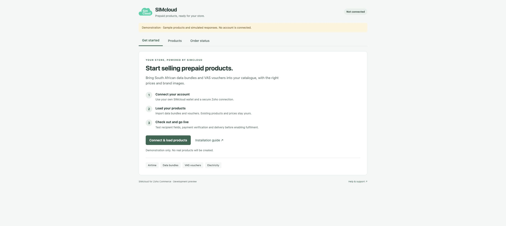
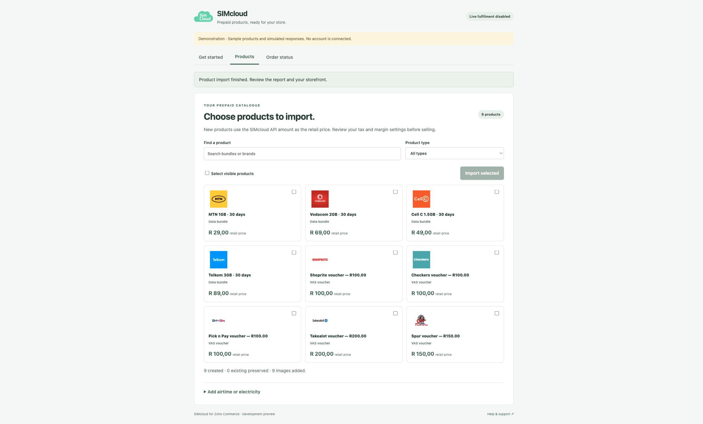

# SIMcloud Zoho Commerce screenshots

These images show the actual local widget with synthetic products, prices and simulated responses. They are suitable for understanding the UI, not proof of account authorization, checkout or live delivery. Real account screens, organization identifiers, connection settings and operational diagnostics do not belong in public documentation.

## Setup demonstration

## Data bundles and VAS vouchers

## Simulated product import

For installation, follow the [step-by-step instructions](installation.md) and Zoho's [official API Configuration guide](https://www.zoho.com/commerce/developer/widgets/api-configurations/), which includes vendor screenshots of the configuration controls. All identifiers and connection values must come from your own workspace and remain private.
